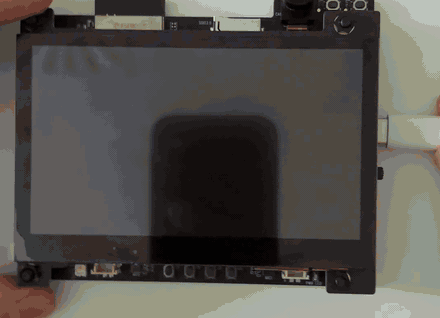

# esp-rusty-doom

Doom in pure Rust on the [ESP32-S31-Korvo-1](https://docs.espressif.com/projects/esp-dev-kits/en/latest/esp32s31/esp32-s31-korvo-1/index.html),
with touch controls on the screen like in mobile shooters.



The [`neurodoom`](https://crates.io/crates/neurodoom) crate runs the game: a `no_std` Rust port of
the Doom engine. The game makes about 32 pictures per second, and the 800x480 panel refreshes at
30 Hz.

## Controls

| Control | What it does |
| --- | --- |
| Left half of the screen | A stick appears under your finger: walk and strafe |
| Right half of the screen | Turn left and right |
| FIRE | Shoot |
| USE | Open doors, press switches |
| WPN | Next weapon that has ammo |

After you die, press FIRE to restart the level.

## How it works

**Game data.** The firmware contains the WAD file. The flash region for code and constants holds
only 4 MB, so `build.rs` compresses the 4.2 MB shareware WAD to 1.77 MB. At boot, the firmware
unpacks it into PSRAM in about 0.7 s.

**Engine.** The game runs on the second core: 35 game tics per second, then one 320x200 picture in
which each pixel is a palette index. The second core needs two changes for this:

- It copies the Physical Memory Attributes (PMA) from the first core, see `src/pma.rs`. The
  bootloader sets them up only on the first core, and without them PSRAM access faults.
- The renderer's depth buffer moves to internal RAM after loading. PSRAM is too slow for it.

**Mailbox.** The first core posts the touch input, and the second core posts the newest picture
with its palette and the player's health, armor and ammo. Each side takes only the newest item, so
neither core waits for the other. See `src/mailbox.rs`.

**Touch controls.** The Goodix touch controller reports up to 5 fingers over I2C. A finger on the
left half becomes a floating walk stick, and a finger on the right half becomes a turn stick. Round
buttons fire, use and switch weapons. The stick offsets become Doom's forward, strafe and turn
values. See `src/controls.rs`.

**Display without a framebuffer.** The LCD's DMA reads two small buffers in internal RAM in a loop,
4 panel rows each. When it finishes one, an interrupt on the first core draws the next 4 rows into
it: each game pixel as 2x2 panel pixels, then the controls and the text on top. See
`src/display.rs` and `src/scene.rs`.

**Why no framebuffer.** At first, the LCD read a 768 KB framebuffer in PSRAM. While both cores used
PSRAM, the DMA fell behind, and each delay shifted the picture to the right. Internal RAM does not
have this traffic, so the LCD always gets its data in time.

**Two hardware details.**

- With its reset settings, the DMA channel signals the end of a buffer (EOF) for only every third
  buffer. The firmware selects the EOF mode that ESP-IDF's RGB LCD driver uses.
- At each VSYNC (the start of a frame), the interrupt puts its row counter back in step with the
  panel. A delayed interrupt can spoil at most one frame.

## Game data

The firmware needs a Doom IWAD. The shareware `doom1.wad` (episode 1, freely distributable) fits.

Get it from the shareware v1.9 package:

```sh
mkdir -p ../wads && cd ../wads
curl -LO https://youfailit.net/pub/idgames/idstuff/doom/doom19s.zip
unzip doom19s.zip && cat DOOMS_19.1 DOOMS_19.2 > dooms.zip && unzip -o dooms.zip DOOM1.WAD
mv DOOM1.WAD doom1.wad
md5 doom1.wad # f0cefca49926d00903cf57551d901abe
```

By default, the build reads `../wads/doom1.wad`. To use another file, set `DOOM_WAD`:

```sh
DOOM_WAD=/path/to/doom1.wad cargo run --release
```

## Build and flash

```sh
cargo run --release
```

The image is about 2 MB, so `cargo run` flashes at 921600 baud. Every 5 seconds, the firmware
prints the frame rate and how busy the display interrupt is.

## Limits

- The engine has no sound and no menus.
- Only the ESP32-S31-Korvo-1 with its LCD subboard is supported.
